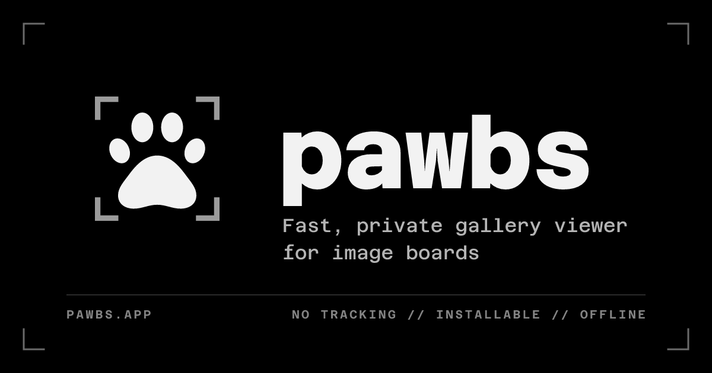

# pawbs: a fast, private e621 & e926 viewer

**[pawbs.app](https://pawbs.app)** is a free, open-source e621 and e926 client that runs in the browser
and installs as an app on phones, tablets and computers. No accounts of its own, no ads, no analytics: requests go
straight from your browser to e621 or e926, and what you keep stays on your device.



## Features

- **Search** with tag autocomplete, a query assistant for e621's search syntax, saved searches and
  tags to refine the results.
- **Browse** in justified rows, masonry or squares: popular posts, followed tags with new-post counts
  (kept in sync with your e621 account's followed tags if you like), pools and comics in reading order.
- **View** in a full-screen gallery with keyboard and swipe controls, zoom, video scrubbing, slideshow,
  notes, and details (tags, wiki, comments, pools).
- **Keep** favourites, collections and sets on the device, with or without an e621 account, and a
  blacklist in e621's own syntax.
- **Move** everything to another device with a QR code (encrypted on the device), or back it up to a file.
- **Lock** it all if you like: encrypted on the device, opened with a passkey or a password, locked again
  after a while.
- **Fast**: preloading, requests paced under the API's rate limit, and an app shell that opens offline.

All features: [pawbs.app/features](https://pawbs.app/features) · FAQ: [pawbs.app/faq](https://pawbs.app/faq).
Works with e621, e926 and other boards that offer e621's API. pawbs is unofficial and not affiliated
with e621 or e926.

## Privacy

Searches, pictures and your optional API key go only to the site you browse. Favourites, history and
settings live in the browser (IndexedDB). The server only delivers the app and, for a device transfer,
holds an encrypted blob for five minutes and hands it out once. Details:
[pawbs.app/privacy](https://pawbs.app/privacy) and [docs/technical.md](docs/technical.md).

## Run your own

```sh
docker run -d --name pawbs -p 8080:8080 registry.gitlab.com/pawbs.app/pawbs:latest
```

The image (`:latest`, `:X.Y.Z` to pin a release, or `:beta` for the changes being tried before a
release) is built and tested by the GitLab pipeline, for amd64 and arm64; `docker build -t pawbs .` builds the same from a clone. An unprivileged nginx on port
8080 serves the build with security headers, pre-compressed files and the transfer relay;
`deploy/docker-compose.yml` does the same with Compose. `dist/` also works on any static host over
HTTPS, without device transfers.

## Develop

```sh
npm install
npm run dev     # http://localhost:5173
npm run build   # type-check, then build into dist/
```

Vue 3, TypeScript and Vite, on Node 26. Storage keys and file formats keep the code's older name,
`nggallery`, so existing data and backups stay compatible. More in [docs/technical.md](docs/technical.md).

The code lives on GitLab, [gitlab.com/pawbs.app/pawbs](https://gitlab.com/pawbs.app/pawbs), where CI
builds and releases it; [github.com/pawbs-app/pawbs](https://github.com/pawbs-app/pawbs) is a mirror.

## Contact

Bugs and ideas: [contact@pawbs.app](mailto:contact@pawbs.app) or an issue on this repository.

## License

Copyright © 2026 the pawbs authors. pawbs is free software under the
[GNU Affero General Public License v3.0](LICENSE): you may use, study, share and modify it, and if you
run a modified version for others over a network, you must offer them its source. The Azeret Mono
typeface is under the SIL Open Font License ([public/OFL.txt](public/OFL.txt)).
